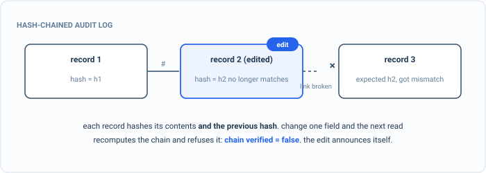

_Part of my [AI Security Engineering](/blog/the-plan/) series, a local email-to-calendar agent I build, then attack, then harden. If you have not set up the lab yet, start with [Set up your lab](/blog/setting-up-the-lab/). The lessons are [on GitHub](https://github.com/t0ul/ai-security-engineering), and the agent itself lives at [t0ul/emaildrop](https://github.com/t0ul/emaildrop)._

## See it before you stop it

[Last post](/blog/attacking-the-baseline/) ended on a red board: a catalog of attacks the agent cannot yet withstand, with one of them, an injected email, shown landing live. The obvious next move is to start swatting them down. I am not going to, not yet.

Part 2 builds the lens first. The reason is simple and it is the reason this ordering is deliberate: when the agent does something wrong, and in [the baseline](/blog/attacking-the-baseline/) it did, your only account of what happened is the log. Without one you get the worst sentence in this work, "it returned zero events and I have no idea why," and no way to tell a bug from an attack. So before any defense, the agent needs to narrate itself. But a log is only evidence if it is honest, and this post is about making it honest, because an attacker who can rewrite your log can rewrite history.

This is a control lesson and it runs on its own, no model involved:

```bash
cd posts/03.1-a-log-you-can-trust
go run .
```

## I. A plain log, and the edit it cannot see

Here is the audit log I would write first: one line per step the agent takes, appended to a file.

```go
func plainLog(path string, steps []step) error {
	var b strings.Builder
	for _, s := range steps {
		fmt.Fprintf(&b, `{"trace":%q,"span":%q,"event":%q,"detail":%q}`+"\n", s.trace, s.span, s.event, s.detail)
	}
	return os.WriteFile(path, []byte(b.String()), 0o644)
}
```

It is readable and it is honest about what happened. It also has no integrity whatsoever, which is the whole problem. The run it records is three steps of one request, and the middle one is the one that matters: the injection guard blocking the exact kind of attack from the last post.

```
{"trace":"4a4778fc","span":"request","event":"start","detail":"source=newsletter.txt"}
{"trace":"4a4778fc","span":"injection_guard","event":"blocked","detail":"dropped injected event: Principal's Gala"}
{"trace":"4a4778fc","span":"event_extractor","event":"written","detail":"PTA Meeting 2026-09-24"}
```

That middle line is the record of the agent stopping an attack, so it is exactly what an intruder who reaches the disk wants gone. They do not need to break the agent; they just edit the file, flipping `blocked` to `allowed`, and now the log says the injected event was fine all along:

```
== before: a plain log ==
  after the edit, the log reads:
    {"trace":"4a4778fc","span":"injection_guard","event":"allowed","detail":"dropped injected event: Principal's Gala"}
  re-reading a plain log just believes the file. the forgery is invisible.
```

Read the log back and it believes the file, because believing the file is all a plain log can do. There is no before to compare against, no signature, nothing that knows the line changed. The evidence now says the opposite of what happened, and nothing on your machine can tell. An attacker who owns the log owns the story.

## II. A chain the edit breaks



*Change one field and its hash stops matching the link the next record stored. Reopening recomputes the chain and refuses it, so the edit cannot hide.*

The fix is to make every record depend on the one before it, so that changing any record invalidates every record after it. That is what a hash chain is, and I did not write one by hand; I added `gledger`, a small, dependency-free Go library that is a tamper-evident audit log for exactly this job. It gives each record a `prev` field holding the hash of the previous record and a `hash` field over its own contents, so the whole log is a chain. It also carries one `trace_id` across every step of a request, so you can tie a run together and answer the "why zero events" question, and it redacts secrets and defangs log-injection on the way in, which the next section shows. What it defends against is precisely the move above: an edited record no longer hashes to what the next record expects, and a verify walk catches the break.

Recording the same run through gledger looks the same to write, `log.Emit(trace, span, event, fields)` per step, but each line now lands in the chain. Verify it and then make the identical edit:

```
== after: gledger's hash-chained log ==
  before the edit: chain_ok=true over 3 records
  after the edit:  chain_ok=false (the chain breaks at the tampered record)
```

`chain_ok=true over 3 records` before, `chain_ok=false` after the same `blocked` to `allowed` edit. The verifier re-walks the file, recomputes each record's hash, and finds that the tampered line's hash no longer matches what the chain records, so it reports the log as broken. The forgery that was invisible in the plain log is now a loud failure. This is the receipt, and it is real: the demo edits the real file on disk and calls gledger's own verifier, the same one the agent runs over its audit trail. The result is free to come out either way, and tampering makes it come out false.

## III. The secret that should never be there

There is a second way a log betrays you, quieter than tampering: it writes down something it should not. Suppose the agent logs a config line that happens to contain a token. The plain log writes it verbatim, so your secret is now sitting in a file, in the clear, for anyone who reads logs:

```
  plain log:   {"trace":"9f12","span":"config","event":"loaded","detail":"token=ghp_s3cr3tLiveKey99"}
```

gledger redacts it on the way in, matching common secret shapes and replacing the value before the record is ever written:

```
  gledger:     {"event":"loaded","fields":{"detail":"<SECRET=redacted>"},...,"hash":"ef868746...","prev":"","service":"agent","trace_id":"9f12",...}
```

```
  plain log leaked the token: true    gledger redacted it: true
```

The token is gone, replaced by `<SECRET=redacted>`, and what remains is a normal chained record. (The `hash` and timestamp are per-record, so yours will differ.) The same pass neutralizes control characters, which closes a related trick: an attacker who gets a newline into a logged value can, in a plain log, forge whole extra lines that look like real entries. gledger turns those characters into spaces, so a value can never break out and become its own record.

## Conclusion

So the agent now has a log that is hard to forge and does not hoard secrets: every record chained to the last, a single trace id tying a run together, tampering caught by a verify, secrets redacted before they land. It is the plainest possible version of a security property the rest of the book leans on constantly, that your evidence has to be trustworthy before it is worth anything, and it cost one small library and no change to how the agent writes its log.

A log tells you what the agent did. It does not stop the agent from reaching somewhere it should not. The next post builds the other half of the lens: a gateway every model call has to pass through, one choke point you cannot route around, so that "what host did it contact" has one honest answer and a bad one can be refused.

## Take it to your own project

Give your agent a log you could hand to an auditor:

- Record every security-relevant step: what was decided, by whom, under which trace id.
- Hash-chain the records so editing one breaks the chain on the next read.
- Redact secrets and personal data before they reach the log.
- Verify the chain when you read it, and refuse to trust a log that does not verify.
