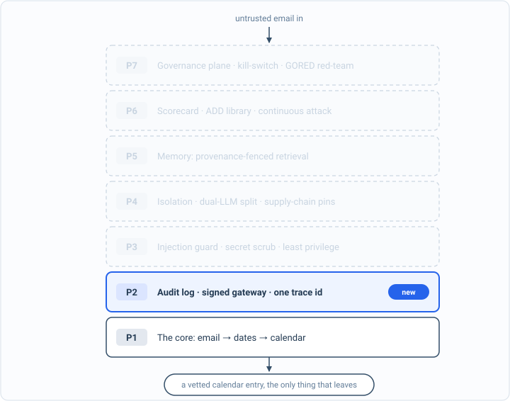

_Part of my [AI Security Engineering](/blog/the-plan/) series, a local email-to-calendar agent I build, then attack, then harden. If you have not set up the lab yet, start with [Set up your lab](/blog/setting-up-the-lab/). The lessons are [on GitHub](https://github.com/t0ul/ai-security-engineering), and the agent itself lives at [t0ul/emaildrop](https://github.com/t0ul/emaildrop)._

## The thread that ties it together

Part 2 built [a log you can trust](/blog/a-log-you-can-trust/) and [a gateway you cannot route around](/blog/a-gateway-you-cannot-route-around/). This short post is the payoff that turns those two things from a pair of files into a lens, and it is the one thing I did not have to build, because it was already there once the first two were done. There is nothing to attack here. It is the free reward for instrumenting the agent properly, and it is worth pausing on before the defenses start, because it is what we will watch them through.

The thread is a single id. Every record the agent writes, every call the gateway passes, carries one `trace_id` for the request it belongs to. Run one email through the agent and watch the log narrate it:

```bash
EXTRACT_MODE=regex DROP_DIR=./drop ./emaildrop --once
```

```
🧾 [request] start trace=61148d2b
🧾 [index] stored trace=61148d2b
🧾 [pipeline] classified trace=61148d2b
🧾 [event_extractor] start trace=61148d2b
🧾 [event_extractor] result trace=61148d2b
🧾 [item_extractor] result trace=61148d2b
🧾 [action_items] result trace=61148d2b
🧾 [digest] result trace=61148d2b
🧾 [contacts] result trace=61148d2b
🧾 [pipeline] summary_written trace=61148d2b
🧾 [request] end trace=61148d2b
🧾 [watcher] handled trace=61148d2b
```

One email, one id, every stage. The request starts, the mail is indexed, classified, run through each extractor, summarized, and filed, and all twenty-three steps of it share `trace=61148d2b`. Nothing in the agent had to pass that id around by hand; gledger stamps it on the way out and the gateway carries it end to end, so it is simply on everything.

## The run as one honest story

That shared id is what lets you ask the log a real question: show me everything that happened in this one request. Each of those lines is a chained record from the last post, so under the hood the first one looks like this:

```json
{"event":"start","fields":{"source":"newsletter.txt"},"span":"request",
 "service":"watcher","trace_id":"61148d2b248c1a23c0bd3e5659b9a66c",
 "prev":"","hash":"f1898cfc...","ts":"2026-10-12T04:10:58Z"}
```

The `trace_id` is the full form of the short one in the stream, and the `prev` and `hash` are the chain. So pulling a run by its id does not just gather its lines, it gathers a run you can verify. Point the verifier at the log and the whole thing checks out:

```
chain_ok=true records=23
```

That is the two halves of Part 2 meeting. The trace id says which records belong to this request, and the hash chain says none of them were edited after the fact. When something goes wrong, and in a few posts something will, "it returned zero events and I have no idea why" is replaced by a specific, ordered, tamper-evident account of the one run that did it. You can reach for the id and read the whole story, and trust what you read.

## The operator window you did not build

Here is the part I like, because it cost nothing. The audit log is structured, correlated, and trustworthy, which means anything that reads it back is an operator tool. The agent's own interface has an activity view that is exactly that: it reads the same `audit.jsonl` and renders it as a plain-language feed of what the agent did, grouped by trace, so a run is one expandable entry instead of twenty-three scattered lines. Alongside it sits the command stream, the raw tool calls the agent made, each with the gateway's allow-or-block decision next to it, correlated by the same id. Click a trace and you replay that request: what came in, what the model was asked, what the gateway permitted, what came out.

I did not write a logging system for the UI and a separate one for the audit. There is one log, instrumented once, and the operator view is a reader over it. That is the whole argument for doing observability first and properly: the trustworthy record you need for security is the same record that makes the thing operable, and you get the second for free when you build the first.




*The architecture so far. Everything solid is built and attacked; P2 is what this part added. The faded layers are the map of what is still ahead.*

## Conclusion

So the lens is finished. The agent can tell you what it did, in a record that cannot be quietly forged; every model call goes through one door where the host is fixed and the rate is capped; and a single trace id threads all of it, so any one request is a story you can pull up, read in plain language, and verify. We built the ability to see and to say no before building a single model-facing defense, on purpose.

Now we use it. Part 3 opens on the first red line from the baseline, the injected email that made the agent invent an event, and this time we do not just watch it land. We watch it land by its trace, add the control, and watch the same trace come back clean. The lens is how every defense from here gets proven.
