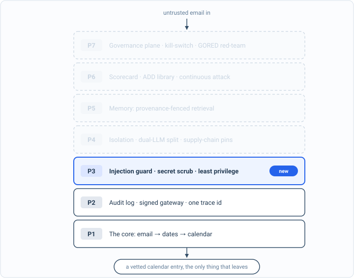

_Part of my [AI Security Engineering](/blog/the-plan/) series, a local email-to-calendar agent I build, then attack, then harden. If you have not set up the lab yet, start with [Set up your lab](/blog/setting-up-the-lab/). The lessons are [on GitHub](https://github.com/t0ul/ai-security-engineering), and the agent itself lives at [t0ul/emaildrop](https://github.com/t0ul/emaildrop)._

## The attack that never finishes

The last two posts fenced what the agent may do and who has to approve it. This one is about an abuse that slips past both, because it never tries to finish an action and never oversteps a capability. It just refuses to stop. An agent that moves from one step to the next, plan then act then plan again, can be pushed into a cycle that never reaches an end, by a bug in its routing or by an instruction that keeps it busy. Each trip around that cycle is real work: a model call, a tool run, time and money spent. With nothing to stop it, it runs until the machine falls over or the bill arrives. That is denial of service aimed at the agent itself, OWASP LLM10, and it is the last control in this part. It is deterministic, no model:

```bash
cd posts/06.3-circuit-breakers
go run .
```

The whole program is on this page, in the order it runs, so you can type it in instead of cloning. Make an empty folder, run `go mod init breaker`, then `go get github.com/t0ul/gonductor@` followed by the version on the `require` line below, and put the code in one file called `main.go`:

<!-- listing: go.mod#all -->
```
module github.com/t0ul/ai-security-engineering/posts/06.3-circuit-breakers

go 1.27.1

// The agent's real loop engine with its circuit breaker. No overrides.
require github.com/t0ul/gonductor v0.0.0-20261006173449-0ff2040c669a
```
<!-- /listing -->

## The spine of the program

Two numbers at the top. The safety ceiling bounds the naive loop so this page cannot hang your machine; reaching it means the loop never terminated on its own. The cap is the engine's hard step limit for the defended run, set low so you can see it bite. `main` runs the loop both ways.

<!-- listing: main.go#head -->
```go
// Command main is the runnable demo for lesson 06.3, circuit breakers and runaway
// loops.
//
// Run it with:
//
//	go run .
//
// An agent loop that can cycle without reaching a finish is a denial-of-service
// waiting to happen: each step is a model call that costs time and money, and a
// cycle with no cap spins forever. This demo runs a two-node cycle with a naive
// loop that has no limit, then through the agent's real loop engine, whose hard
// step cap trips a circuit breaker and stops it. Deterministic, no model.
//
// Reader safety: the naive loop here is bounded by a ceiling so the demo cannot
// actually hang your machine. In a real agent each iteration is a paid model call,
// so "unbounded" is the whole danger; we show that it never stops on its own, then
// stop it for real with the cap.
package main

import (
	"context"
	"errors"
	"fmt"
	"os"

	"github.com/t0ul/gonductor"
)

// safetyCeiling bounds the naive loop so this demo cannot hang. It stands in for
// "forever": reaching it means the loop never terminated on its own.
const safetyCeiling = 100000

// cap is the engine's hard step limit for the defended run.
const cap = 8

func main() {
	ran := naiveSpinsForever()
	tripped := breakerStops()

	fmt.Println()
	if ran && tripped {
		fmt.Println("attack blocked (the receipt): the naive loop never stops itself; the breaker stops it at the cap")
	} else {
		fmt.Println("a control did not hold")
		os.Exit(1)
	}
}
```
<!-- /listing -->

## I. A loop with no off switch

Here is the loop the way you might first write it: go from plan to act and back, forever, with no condition that ever ends it. I am not going to actually run that forever, so the demo puts a ceiling on it purely so this page cannot hang your machine. Reaching the ceiling is the point: it means the loop never decided to stop on its own.

<!-- listing: main.go#before: a loop with no limit -->
```go
// ---- before: a loop with no limit ----

// naiveLoop walks the same two-step cycle the agent would (plan, act, plan, act),
// with no condition that ever ends it. It stops only at the safety ceiling, which
// is this demo refusing to actually run forever, not the loop deciding to.
func naiveLoop() int {
	steps := 0
	node := "plan"
	for steps < safetyCeiling {
		steps++
		if node == "plan" {
			node = "act"
		} else {
			node = "plan"
		}
		// There is no `if done { break }` here, because nothing makes it done.
	}
	return steps
}

func naiveSpinsForever() bool {
	fmt.Println("== before: a loop with no cap ==")
	steps := naiveLoop()
	hitCeiling := steps >= safetyCeiling
	fmt.Printf("  the loop ran %d steps and still had not finished (stopped only by the demo's ceiling): %v\n", steps, hitCeiling)
	fmt.Println("  in the real agent each step is a paid model call, so this is denial of wallet")
	return hitCeiling // it never terminates on its own: the attack lands
}
```
<!-- /listing -->

```
== before: a loop with no cap ==
  the loop ran 100000 steps and still had not finished (stopped only by the demo's ceiling): true
  in the real agent each step is a paid model call, so this is denial of wallet
```

A hundred thousand steps and still going, stopped only because I refused to let the demo run longer. In the real agent that ceiling is not there, and each of those steps is a call to a model that costs you, so the loop does not just hang, it spends. Nothing in the loop itself was ever going to say enough.

## II. A hard cap on the work

The agent does not run its loop by hand. It runs on `gonductor`, a small dependency-free engine that drives the multi-step plan-approve-act loop as a graph of nodes, and the engine owns the one thing a hand-written loop forgot: a hard limit on how many steps a single run may take. Exceeding it does not warn or slow down, it fails the run with a circuit-breaker error, so a routing cycle that would otherwise spin forever is stopped dead. It is defense in depth by design: the engine-level cap is the hard backstop, and a node can also watch its own step count and route to a graceful halt before the cap is reached. What it defends against is exactly the runaway above: no matter why the loop will not end, it cannot run more than the cap allows.

Run the same endless cycle on the engine, with the cap set low so you can see it bite. The graph is two nodes and two edges, the second edge closing the cycle so it never routes to the end, and `MaxSteps` is the breaker:

<!-- listing: main.go#after: the engine's hard step cap -->
```go
// ---- after: the engine's hard step cap ----

// breakerStops builds the same never-ending cycle on the agent's real loop engine,
// which enforces a hard maximum number of steps and fails the run when it is hit.
func breakerStops() bool {
	fmt.Println("\n== after: the loop engine's circuit breaker ==")

	g := gonductor.New[int]()
	g.AddNode("plan", func(_ *gonductor.Context, s int) (int, error) { return s + 1, nil })
	g.AddNode("act", func(_ *gonductor.Context, s int) (int, error) { return s + 1, nil })
	g.AddEdge("plan", "act")
	g.AddEdge("act", "plan") // the cycle: it never routes to END
	g.SetEntry("plan")
	g.MaxSteps(cap)

	compiled, err := g.Compile()
	if err != nil {
		panic(err)
	}
	final, runErr := compiled.Invoke(&gonductor.Context{Context: context.Background()}, 0)

	tripped := errors.Is(runErr, gonductor.ErrCircuitBreaker)
	fmt.Printf("  the same cycle, run with a hard cap of %d steps:\n", cap)
	fmt.Printf("  it stopped after %d steps with: %v\n", final, runErr)
	fmt.Printf("  circuit breaker tripped: %v\n", tripped)
	return tripped && final <= cap
}
```
<!-- /listing -->

What happens:

```
== after: the loop engine's circuit breaker ==
  the same cycle, run with a hard cap of 8 steps:
  it stopped after 8 steps with: gonductor: circuit breaker tripped (max steps exceeded)
  circuit breaker tripped: true
```

Eight steps and then a clean stop with a circuit-breaker error. The loop that ran a hundred thousand steps without finishing is held to eight, because the limit lives in the engine and not in the hope that the loop will end itself. The denial-of-wallet attack has a ceiling now, and it is one you set.

That is the whole program. Its tests assert both halves and that the breaker's error is the engine's own sentinel, so a caller can tell a trip from any other failure. Put them next to `main.go` as `contract_test.go`:

<!-- listing: contract_test.go#all -->
```go
package main

import (
	"context"
	"errors"
	"testing"

	"github.com/t0ul/gonductor"
)

// Deterministic, no model. The naive loop never terminates on its own (it reaches
// the demo's safety ceiling); the engine's hard cap trips the circuit breaker and
// stops the same cycle.

func TestNaiveLoopNeverTerminates(t *testing.T) {
	if !naiveSpinsForever() {
		t.Fatal("the uncapped loop should run to the ceiling without finishing; otherwise there is nothing to fix")
	}
}

func TestCircuitBreakerTrips(t *testing.T) {
	if !breakerStops() {
		t.Fatal("the engine's step cap must trip the circuit breaker on an endless cycle")
	}
}

func TestBreakerErrorIsSentinel(t *testing.T) {
	g := gonductor.New[int]()
	g.AddNode("a", func(_ *gonductor.Context, s int) (int, error) { return s + 1, nil })
	g.AddEdge("a", "a")
	g.SetEntry("a")
	g.MaxSteps(3)
	c, err := g.Compile()
	if err != nil {
		t.Fatal(err)
	}
	if _, runErr := c.Invoke(&gonductor.Context{Context: context.Background()}, 0); !errors.Is(runErr, gonductor.ErrCircuitBreaker) {
		t.Fatalf("expected ErrCircuitBreaker, got %v", runErr)
	}
}
```
<!-- /listing -->

## The board, at the end of Part 3



*The architecture so far. Everything solid is built and attacked; P3 is what this part added. The faded layers are the map of what is still ahead.*

This post closes the part, so it is time to look at the scorecard the whole book is built to turn green. Back in [the baseline post](/blog/attacking-the-baseline/) the undefended agent lit up red across the model surface. Here is the board now, after three parts of work:

```
id     slug                               part                     result
00.1   the-plan                           P0 front matter          intro
00.2   setting-up-the-lab                 P0 front matter          intro
00.3   attack-driven-design-shown-once    P0 front matter          method
01.1   one-shape-for-everything           P1 ch1 parser            feature
01.2   dates-the-model-never-decides      P1 ch1 parser            green
01.3   inert-output-and-the-human-accept  P1 ch1 parser            green
01.4   the-watched-folder                 P1 ch1 parser            green
02.1   the-eval-harness                   P1 ch2 prove it          method
02.2   attacking-the-baseline             P1 ch2 prove it          problem
03.1   a-log-you-can-trust                P2 ch3 observability     green
03.2   a-gateway-you-cannot-route-around  P2 ch3 observability     green
03.3   one-trace-id                       P2 ch3 observability     method
04.1   when-the-email-gives-orders        P3 ch4 injection         green
04.2   the-email-is-data-not-orders       P3 ch4 injection         green
04.3   system-prompt-leakage              P3 ch4 injection         green
05.1   scrubbing-secrets-and-pii          P3 ch5 secrets and output green
05.2   the-calendar-field-exfil           P3 ch5 secrets and output green
05.3   the-tracking-pixel                 P3 ch5 secrets and output green
05.4   a-search-tool-hits-a-local-server  P3 ch5 secrets and output green
06.1   least-privilege                    P3 ch6 agency            green
06.2   the-human-gate                     P3 ch6 agency            green
06.3   circuit-breakers                   P3 ch6 agency            green

green 15  red 0  intro 2  feature 1  method 3  problem 1  not yet 39
```

Every lesson that has a control runs green, and `make board` re-runs all of them on every push, so a line that went green cannot quietly go red again without the gate catching it. The injection, the leaks, the exfiltration, the over-agency, the runaway loop, each one landed against the agent at the start of this book and each one now ends on a refusal you can reproduce. The rows still marked `not yet` are the next three parts, and the rows labelled intro, feature, method, or problem are the posts that set up or teach rather than defend.

## Conclusion

That closes Part 3, and with it the part of the agent you can secure without ever letting it run code. The model surface is covered: an email can no longer give the agent orders, fish out its instructions, smuggle data in or out, overstep a tool's privilege, forge an approval, or spin it in place. All of it was proven against the real model, and all of it is held by a gate that runs before every push.

Part 4 is where the stakes change kind. The agent is about to get a tool that executes code, and an email that can reach an executor is not the same class of problem as one that can reach a fetcher. A regular expression over a URL is no longer a wall. The next posts build real ones: an isolated machine with no network card where untrusted-influenced code can run and touch nothing, a two-model design that keeps the part reading hostile text from ever being the part that acts, and the broker that is the single audited way anything gets out. It opens by showing, with nothing between the model and a shell, exactly how bad the unguarded version is.

## Take it to your own project

Cap what a single run can do:

- Set a hard cap on steps, tokens, tool calls, and wall-clock time per run.
- Trip a breaker when a cap is hit, and fail closed.
- Alert on a trip; a runaway loop is a signal, not just noise.
- Test it with an input designed to loop forever, and confirm it stops.
