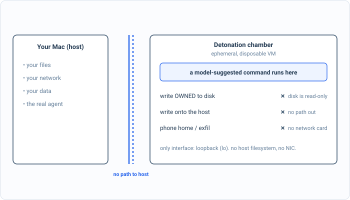

_Part of my [AI Security Engineering](/blog/the-plan/) series, a local email-to-calendar agent I build, then attack, then harden. If you have not set up the lab yet, start with [Set up your lab](/blog/setting-up-the-lab/). The lessons are [on GitHub](https://github.com/t0ul/ai-security-engineering), and the agent itself lives at [t0ul/emaildrop](https://github.com/t0ul/emaildrop)._

## Run it where it cannot reach anything

[The last post](/blog/the-problem-with-running-code/) ended on a command, produced by a model from an email, running on my machine as me. I argued there that you cannot make that safe by inspecting the command, because a shell has endless ways to spell an attack. The real answer is to stop inspecting and start isolating: run the code somewhere that contains nothing and connects to nothing, so that whatever the command turns out to be, it executes against an empty room.

That room is the detonation chamber, and in this agent it is a real virtual machine. The agent does not run untrusted code on the host at all. It boots a small Linux virtual machine using Apple's Virtualization Framework, a machine with no network card and no access to the host's files, and the only way in or out is a single vsock channel the control plane uses to hand it a command and read back the output. Code runs inside that box. The box reaches nothing.

This one is not a self-contained lesson folder like the others, because a virtual machine is not a library you import. It is the real chamber from the product, and running it needs an Apple Silicon Mac and a code-signed binary (the Virtualization Framework refuses to run without the entitlement, so you build and sign `launchvm` rather than `go run` it, exactly as [the emaildrop repo](https://github.com/t0ul/emaildrop) documents). Everything below is a live run against that booted chamber.

## A command runs, but not on my machine

The agent sends a command to the chamber the same way for every command: a small POST to the vsock bridge with the argument list and a trace id, and a line of output comes back. So the simplest possible first check is to ask the chamber what machine it is:

```
HOST (my Mac):        Darwin macOS

== a command, run inside the chamber ==
  uname -a      -> Linux localhost 6.11.5 #1.0.3-PUI PUI! SMP ... aarch64 Linux
  /etc/os-release:
    PRETTY_NAME="Alpine Linux v3.20"
```

My machine is macOS. The command ran on Alpine Linux. That is the whole idea in two lines: the code the agent executes does not run on my computer, it runs inside a different, disposable computer that happens to exist for a moment to contain it. Everything after this is just confirming that the disposable computer is as empty and as sealed as it needs to be.

## The walls, one at a time



*The command that owned the Mac a chapter ago runs here and meets three walls at once: it cannot persist, cannot reach the host, and cannot phone home.*

First, the host's files. If the chamber could see my Mac's filesystem, it would not be isolation, just indirection. It cannot:

```
== can it see my Mac's filesystem? ==
  ls /System    -> ls: /System: No such file or directory
  hostname      -> localhost   (the VM's, not the Mac's)
```

The Mac's `/System` does not exist in there, and the hostname is the virtual machine's own. The chamber has no view of the host at all.

Now the command from the last post, the one that wrote `OWNED-BY-THE-EMAIL` onto my machine. Run the exact same thing inside the chamber:

```
== the command that owned the host in the last post, run here ==
  echo OWNED > /tmp/agent_pwned.txt -> sh: can't create /tmp/agent_pwned.txt: Permission denied
  that file on the HOST:  absent
```

Two things worth noting. The write failed even inside the chamber, because the guest's own filesystem is mounted read-only, a disposable machine has no reason to let code persist anything. And the file is absent on the host, because there is no path from the chamber to the host for it to be written through. The command that owned the Mac a post ago cannot so much as drop a file here.

Last, the network, which is the capability that turns a contained command back into a dangerous one. The chamber has no network card:

```
== does it have a network card? ==
  ls /sys/class/net -> interfaces: lo   (loopback only, no network card)
  wget example.com   -> wget: bad address 'example.com'
```

The only network interface is loopback, the machine talking to itself. There is no card that reaches the host or the internet, so a name like `example.com` cannot even be resolved, let alone contacted. A reverse shell has nowhere to connect back to; an exfiltration has nowhere to send.

## What we actually did

Read back over that and notice what is missing: at no point did anything look at the command and decide it was safe. There is no allow-list of commands, no blocklist of dangerous words, no inspection at all. The command could be `rm -rf /`, a reverse shell, a loop that reads every secret it can find, and it would make no difference, because it runs in a machine that has no files worth deleting, no network to call home on, and no door to the host. We did not make the command safe. We made the room it runs in empty. That is the difference between a filter and a wall, and it is why isolation, not inspection, is the control for code execution.

I will be honest about the chamber's edges, because they are the next two posts. The chamber contains the code, but the code still produces output, and that output comes back across the one channel the chamber has, so a result is only ever data to be handled carefully, never trusted. And there are rare, legitimate times a tool genuinely does need the network, which is why the chamber has that vsock channel at all and why the agent runs an audited broker as the single controlled way anything reaches out. The chamber is the foundation. The one door it has is locked down next.

## Conclusion

The most dangerous capability in the whole series, running code produced from an untrusted email, is now survivable, not because we got clever about reading commands, but because the command runs in a box with no host, no network, and nothing to persist to. The same line that owned my machine two posts ago ran here and reached nothing, which I did not describe, I ran it and watched it fail.

The chamber has exactly one channel out, the vsock bridge that carries the command in and the output back. The next post is about the moment a tool legitimately needs more than that, a real network fetch, and the broker that makes that one audited exception without reopening the door we just closed.

## Take it to your own project

Run untrusted code where it can reach nothing:

- Execute any model-suggested code in an isolated VM or sandbox, never on the host.
- Give it no view of the host filesystem, a read-only disk, and no network card.
- Treat the sandbox as disposable; a run leaves nothing behind.
- Assume code inside is hostile and design for it to escape nothing.
