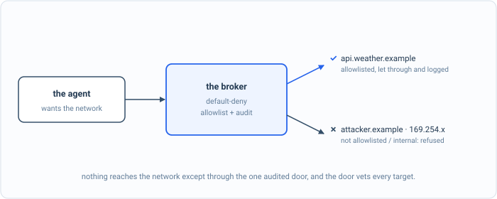

_Part of my [AI Security Engineering](/blog/the-plan/) series, a local email-to-calendar agent I build, then attack, then harden. If you have not set up the lab yet, start with [Set up your lab](/blog/setting-up-the-lab/). The lessons are [on GitHub](https://github.com/t0ul/ai-security-engineering), and the agent itself lives at [t0ul/emaildrop](https://github.com/t0ul/emaildrop)._

## Safe is not the same as useful

[The last post](/blog/the-detonation-chamber/) put untrusted code in a box with no network card, so a command from an email could run and reach nothing. That is safe, and it is also too absolute to be the final answer, because every so often a tool genuinely needs the network. The user asks what the weather is for an outdoor event, a tool needs to call a real API, and a chamber that can never reach anything cannot do that job. A box with no exits is secure the way a brick is secure.

So the chamber gets exactly one way out, and the shape of it is the whole lesson. It is not a network card the guest controls, because then the guest could reach anywhere. It is a broker that runs on the host, and the only thing the guest can do is ask it. When code inside the chamber wants the network, it opens the chamber's one channel to the broker and sends a single line, the host and port it wants to reach, and the broker decides. The guest never dials anything. It can only make a request that the host is free to refuse. This is a control lesson, deterministic, no model:

```bash
cd posts/07.3-egress-deny-and-the-broker
go run .
```

## I. One door, with no lock

Here is the broker written the easy way: read the target the guest asked for, dial it, and tunnel the bytes. It is the chamber's one door, propped wide open. Now a tool inside the chamber, subverted by an email, asks it not for the weather API but for an internal service on the host's own network:

```
== before: a broker with no policy ==
  the guest asked the broker for internal.example:<port>
  it got back: "INTERNAL-SECRET: db credentials" (internal service hit 1 time(s))
```

The isolation from the last post just evaporated. The chamber has no network card, exactly as designed, and it did not need one, because the broker reached the internal service on its behalf and handed the secret back through the tunnel. A door with no lock is not better than no wall; it is a wall with a hole cut in a convenient shape. The whole point of denying the chamber a NIC was to decide egress ourselves, and a broker that dials whatever it is told hands that decision right back to the attacker.

## II. A door that vets every target



*An allowlisted host is let through and logged; an attacker host or an internal address is refused. Nothing reaches the network except through the one vetted door.*

The real broker makes the decision it was built to make. The chamber still has no route of its own; when code inside needs the network it sends the broker a single line with the target, and before the broker dials anything it runs that target through the same egress authority from [the web-search post](/blog/a-search-tool-hits-a-local-server/), `netpolicy`: a default-deny allowlist, host resolution, a refusal of any address that is loopback, private, or the cloud-metadata endpoint, and dial-pinning to the vetted address so the name cannot rebind to somewhere else between the check and the connection. If the target passes, the broker answers `OK` and tunnels raw bytes. If it does not, the broker answers `ERR` and closes, never having opened a connection.

One detail in that design matters more than it looks. The broker tunnels bytes; it does not speak HTTP. The guest runs the TLS and the HTTP over the tunnel itself, which means the untrusted response from the network is parsed inside the chamber and never by the host. Execution stays in the box, content handling stays in the box, and the host's only job is to be a single, audited chokepoint that decides yes or no on a destination. Here is the same chamber, now behind the real broker, asking for the forbidden host and then a permitted one:

```
== after: the agent's real broker ==
  internal.example: refused (internal service hit 0 time(s))
  weather.example:  tunneled, got: ALLOWED: this week's weather
```

The internal service is refused and never touched, zero hits, because its host is not on the allowlist. And the weather host, which is, tunnels through and the tool gets its answer. The chamber has exactly one way to reach the network, that way is the broker, and the broker reaches only what you allowed.

## The shape of the exit

It is worth stating plainly what makes this safe, because it is the inverse of how egress usually works. Normally a process has a network connection and you try to restrict it. Here the chamber has no connection at all, and the only thing it can do is ask a separate program, on the other side of the isolation boundary, to make a specific connection for it. The decision lives entirely on the host, in one place, logged, default-deny. The attacker inside the chamber cannot open a socket, cannot resolve a name, cannot rebind a host, cannot read a response on the host's behalf. It can only ask, and the answer is no unless the destination was one you chose in advance. That is the difference between restricting egress and owning it.

## Conclusion

The chamber now has a single controlled, audited exit. Code inside can do its job when the job honestly needs the network, and it still cannot reach anything you did not permit, because the permission is decided outside the box by a broker that dials only the allowlist and tunnels bytes it never reads.

There is one hole left in the isolation story, and it is back at the very start of this chapter, in how a command gets into the chamber in the first place. We have been handing the chamber commands, and a command is a string, and a string handed to a shell is a small programming language an attacker can write in. The last post of this part closes that: arguments as an array checked against an allowlist, with no shell to be clever with, so that even the command going in is not a sentence the attacker gets to compose.

## Take it to your own project

Make the network default-deny with one audited exit:

- Deny all egress by default.
- Route the rare legitimate call through a single broker that vets the target.
- Allowlist hosts; log every call that goes out.
- No component gets its own quiet path to the network.
