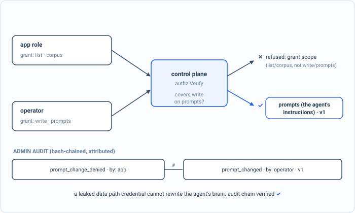

_Part of my [AI Security Engineering](/blog/the-plan/) series, a local email-to-calendar agent I build, then attack, then harden. If you have not set up the lab yet, start with [Set up your lab](/blog/setting-up-the-lab/). The lessons are [on GitHub](https://github.com/t0ul/ai-security-engineering), and the agent itself lives at [t0ul/emaildrop](https://github.com/t0ul/emaildrop)._

## From building it to running it

The agent is finished. Every feature is wired and every attack from the outside is contained. This part is about the other half of security, the half that starts once the thing is deployed and a team has to operate it: who is allowed to change it, what happens when it crashes, and how you prove after the fact what it did. The threats here are not a hostile newsletter. They are a mistaken operator, a leaked credential, a change nobody reviewed.

The first operator power is also the most dangerous one, so it is a good place to start. A real agent needs its prompts changed without a code deploy, because prompts are tuned constantly and waiting on a release for every wording fix is how you end up editing them in production by hand. So the agent resolves its system prompts from a runtime plane an operator can update. But a prompt is not configuration, it is the agent's instructions, and whoever can change the instructions owns the agent. A control lesson, deterministic, no model:

```bash
cd posts/14.1-governed-control-plane
go run .
```

## Change the prompt, own the agent

Here is the plane with no governance on it: a prompt has a name, and you activate a new version. The chat prompt is the one from the last post, the one whose whole job is to tell the model never to obey retrieved text. Watch what an activation with no checks does to it.

```
== before: an ungoverned prompt plane ==
  attacker swapped the chat prompt; the never-obey rule is gone: true
```

One call, and the rule that held the entire retrieval surface closed is gone, replaced with a prompt that says to do whatever the notes say. Every defense from Part 5 was real and is now irrelevant, not because anyone beat it, but because the instruction that enforced it was edited out by someone who was simply allowed to. This is the insider shape of every injection in the book: the agent does what its instructions say, and the instructions became writable.

## A signed capability to make the change



*Changing the agent's instructions is a privileged action. A grant scoped to the data path cannot rewrite the brain, and both the refusal and the approval land on a tamper-evident record.*

The fix is to treat changing a prompt as a privileged action and gate it the way the agent gates every other one, with the capability system from the agency chapter. An operator does not just call activate; they present a Grant, a short-lived token signed by the control plane that says this subject may write this resource. The agent verifies the grant covers write on the prompts resource before it applies anything.

```go
want := controlplane.Capability{Action: controlplane.ActionWrite, Resource: "prompts", Tenant: "public"}
if _, err := authz.Verify(g, want); err != nil {
	audit.Emit(trace, "admin", "prompt_change_denied", gledger.F{"by": g.Subject, "reason": err.Error()})
	return err
}
```

Now give two subjects differently-scoped grants. The app role holds a grant to list the corpus; the operator holds one to write prompts. Both try to change the chat prompt.

```
== after: RBAC-governed prompt changes ==
  app role (list/corpus) tries to swap:  refused: controlplane: grant does not cover requested scope
  the live prompt still has the rule:    true
  operator (write/prompts) changes it:   applied=true, version=1
```

The app role is refused, not because its grant is forged, it is perfectly valid, but because it authorizes listing the corpus, not writing prompts, and the two are scoped apart on purpose. A credential that leaks from the data path cannot be turned around and used to rewrite the agent's brain. The operator, holding the right scope, makes a real change, and it is versioned so it can be pinned and rolled back.

## Who changed what

The last piece is the one an auditor asks for: not just that the change was authorized, but who made it. Every decision, the refusal and the approval both, is written to the admin audit under a trace id, and the log is the same hash-chained ledger the pipeline uses, so the record of who changed the agent's instructions cannot itself be quietly edited.

```
  audit (who did what):
    prompt_change_denied   map[by:app reason:grant does not cover requested scope]
    prompt_changed         map[by:alice-operator name:chat version:1 hash:a17c35cc386c]
  audit chain verified: true
```

The denied attempt is recorded, not just the successful one, because a refused privileged action is exactly what you want to see when you go looking for who tried. That is governance in one feature: a privileged action needs a signed capability scoped to it, a role that does not have that scope cannot perform it however valid its other powers, and every attempt is on a tamper-evident record attributed to a subject. The operator can change the agent without a deploy; nobody else can change it at all, and the agent remembers which of them did.

The next operator question is about the agent's own credentials rather than the operator's: it now holds tokens to act in the world, and the post is about what happens to those tokens when you need to take them away right now.

## Take it to your own project

Treat changing the agent as a privileged action:

- Require a signed capability scoped to exactly that change.
- Version changes so they can be pinned and rolled back.
- Audit every attempt, the refusals too.
