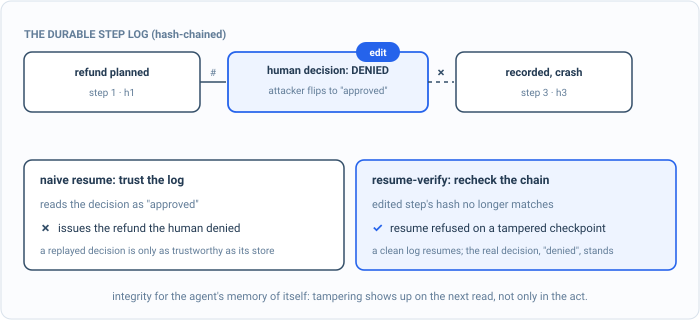

_Part of my [AI Security Engineering](/blog/the-plan/) series, a local email-to-calendar agent I build, then attack, then harden. If you have not set up the lab yet, start with [Set up your lab](/blog/setting-up-the-lab/). The lessons are [on GitHub](https://github.com/t0ul/ai-security-engineering), and the agent itself lives at [t0ul/emaildrop](https://github.com/t0ul/emaildrop)._

## Crashes are not attacks, until they are

The last part governed the agent. This one makes it survive the boring disasters: a crash mid-task, a retry after a timeout, a context window that fills up. These are not attacks, they are the ordinary physics of running software, and the reason they belong in a security book is that the mechanisms you add to survive them become attack surface of their own. A system that can resume is a system that trusts something it wrote down earlier, and anything the agent trusts is worth examining.

Durable execution is the first of them. A long task should not start over from zero every time the process restarts, so the agent records each completed step and, on resume, replays the record instead of redoing the work. That record is a file. A control lesson, deterministic, no model:

```bash
cd posts/15.1-durable-execution
go run .
```

The whole program is on this page, in the order it runs, so you can type it in instead of cloning. Make an empty folder, run `go mod init durable`, then `go get github.com/t0ul/emaildrop@v0.0.0-20261011232453-771805568f76`, and put the code in one file called `main.go`.

<!-- listing: go.mod#all -->
```
module github.com/t0ul/ai-security-engineering/posts/15.1-durable-execution

go 1.27.1

// The agent's real durable, hash-chained step log. No overrides.
require github.com/t0ul/emaildrop v0.0.0-20261011232453-771805568f76
```
<!-- /listing -->

## The spine of the program

`main` runs the workflow to a log on disk, tampers with it, and resumes twice: once by reading the file, once through the durable package, which verifies the chain as it opens. The receipt needs the naive resume to adopt the forged approval, the verified resume to refuse, and a clean log of the same workflow to resume with the denial intact.

<!-- listing: main.go#head -->
```go
// Command main is the runnable demo for lesson 15.1, durable execution and
// resume-verify.
//
// Run it with:
//
//	go run .
//
// A long-running agent crashes and resumes, replaying completed steps from a
// durable log instead of redoing them. That log is on disk, so it is attackable:
// edit a recorded step and the agent resumes into a state it never actually
// reached, an approval that was a denial, a command it never chose. The agent's
// log is a hash chain, so a tampered checkpoint does not verify, and resume fails
// closed rather than trusting a forged state. Deterministic, no model.
package main

import (
	"encoding/json"
	"errors"
	"fmt"
	"os"
	"path/filepath"
	"strings"

	"github.com/t0ul/emaildrop/pkg/durable"
)

func main() {
	dir, _ := os.MkdirTemp("", "durable")
	defer os.RemoveAll(dir)
	path := filepath.Join(dir, "steps.log")

	runWorkflow(path)
	tamper(path) // an attacker flips the denial to an approval on disk

	fmt.Println("== before: resume by trusting the log on disk ==")
	decision := naiveResume(path)
	adopted := decision == "approved"
	fmt.Printf("  the resumed agent reads the approval decision as: %q\n", decision)
	fmt.Printf("  it would issue the refund the human denied: %v\n", adopted)

	fmt.Println("\n== after: resume-verify the hash chain ==")
	_, err := durable.Open(path) // Open loads AND verifies the chain
	refused := errors.Is(err, durable.ErrTampered)
	fmt.Printf("  reopening the tampered log: %v\n", err)
	fmt.Printf("  resume refused on a tampered checkpoint: %v\n", refused)

	// A clean log of the same workflow still resumes, and the real decision stands.
	clean := filepath.Join(dir, "clean.log")
	runWorkflow(clean)
	l, errClean := durable.Open(clean)
	real, _ := l.Lookup(session, "approve")
	fmt.Printf("  a clean log resumes (err=%v); the real decision is: %q\n", errClean, real.Output)

	fmt.Println()
	if adopted && refused && errClean == nil && real.Output == "denied" {
		fmt.Println("attack blocked (the receipt): a naive resume trusts a forged checkpoint and reverses a decision; the hash chain refuses a tampered log and fails closed, while a clean log resumes with the real decision intact")
	} else {
		fmt.Println("a control did not hold")
		os.Exit(1)
	}
}
```
<!-- /listing -->

## Resume into a state that never happened

Here is a workflow with a security-relevant middle: the agent planned a refund, a human was asked and denied it, and the agent recorded the denial and moved on. Then the process crashed. On disk is a log of those completed steps, and an attacker with access to it flips one field: the recorded decision, from denied to approved.

The workflow, the tamper, and the read of the recorded decision:

<!-- listing: main.go#the workflow, the tamper, and what resume reads -->
```go
// ---- the workflow, the tamper, and what resume reads ----

const session = "refund-session"

// runWorkflow records three completed steps to a durable log on disk. The middle
// step is a security decision: the human DENIED the refund.
func runWorkflow(path string) {
	l, _ := durable.Open(path)
	_, _, _ = l.Do(session, "model", "plan", func() (string, error) { return "outline the refund request", nil })
	_, _, _ = l.Do(session, "tool", "approve", func() (string, error) { return "denied", nil })
	_, _, _ = l.Do(session, "model", "finalize", func() (string, error) { return "close the ticket", nil })
}

// tamper edits the persisted log the way an attacker with disk access would: it
// flips the recorded approval decision. The step's stored hash is left as-is, so
// the chain no longer verifies.
func tamper(path string) {
	b, _ := os.ReadFile(path)
	out := strings.Replace(string(b), `"output":"denied"`, `"output":"approved"`, 1)
	_ = os.WriteFile(path, []byte(out), 0o600)
}

// approveDecision reads what the "approve" step recorded, as a resuming agent would.
func approveDecision(steps []durable.Step) string {
	for _, s := range steps {
		if s.Key == "approve" {
			return s.Output
		}
	}
	return ""
}
```
<!-- /listing -->

A resume that reads the log and trusts it picks up exactly where the attacker left it.

<!-- listing: main.go#before: resume by trusting the log on disk -->
```go
// ---- before: resume by trusting the log on disk ----

// naiveResume reads the persisted steps and uses them without checking the chain.
func naiveResume(path string) string {
	b, _ := os.ReadFile(path)
	var steps []durable.Step
	for _, line := range strings.Split(strings.TrimSpace(string(b)), "\n") {
		var s durable.Step
		if json.Unmarshal([]byte(line), &s) == nil {
			steps = append(steps, s)
		}
	}
	return approveDecision(steps)
}
```
<!-- /listing -->

```
== before: resume by trusting the log on disk ==
  the resumed agent reads the approval decision as: "approved"
  it would issue the refund the human denied: true
```

The agent is now about to issue a refund that a human explicitly refused, not because anyone tricked the model or beat a control at runtime, but because the memory of what happened was editable and the agent believed its own notes. Durable state is a replayed decision, and a replayed decision is only as trustworthy as the thing that stored it.

## A log that cannot be edited quietly



*A naive resume trusts the log and would issue the refund the human denied. Resume-verify recomputes the chain, the edited step no longer matches, and the resume halts instead.*

The agent's durable log is not a plain file of steps, it is a hash chain. Each recorded step includes a hash over its own contents and the previous step's hash, so the steps are linked: change any field of any step and its hash no longer matches, which breaks the link to every step after it. Reopening the log recomputes the whole chain and refuses it if a single thing has moved.

```
== after: resume-verify the hash chain ==
  reopening the tampered log: durable: step log hash-chain does not verify (tampered checkpoint)
  resume refused on a tampered checkpoint: true
  a clean log resumes (err=<nil>); the real decision is: "denied"
```

The tampered log does not load. The agent refuses to resume rather than resume into a forged state, which is the right default: a corrupt or edited checkpoint is a reason to stop and get a human, not to guess. And a clean log of the same workflow resumes normally, with the human's actual denial intact, so durability still works, it just works verifiably. The edit that silently reversed a decision a moment ago now announces itself and halts the resume.

## Integrity for the agent's memory of itself

This is the same hash-chain idea as the audit ledger, turned toward a different job. The audit trail proves what the agent did for an investigator reading it later; the durable log proves what the agent did to the agent itself, before it acts on that memory again. In both, integrity comes from chaining, so that tampering is not something you have to catch in the act but something the data structure reveals on the next read. An agent that resumes is remembering, and a memory you cannot verify is a memory an attacker can rewrite.

That is the whole program. Its tests assert the forged adoption, the refusal, and the clean resume each on their own; put them next to `main.go` as `contract_test.go`:

<!-- listing: contract_test.go#all -->
```go
package main

import (
	"errors"
	"os"
	"path/filepath"
	"testing"

	"github.com/t0ul/emaildrop/pkg/durable"
)

// Deterministic, no model. A naive resume trusts a forged checkpoint and reverses a
// decision; reopening the hash-chained log fails closed on a tampered checkpoint,
// while a clean log resumes with the real decision intact.

func TestNaiveResumeAdoptsForgedState(t *testing.T) {
	dir := t.TempDir()
	path := filepath.Join(dir, "steps.log")
	runWorkflow(path)
	tamper(path)
	if naiveResume(path) != "approved" {
		t.Fatal("a naive resume must adopt the tampered decision; otherwise there is nothing to defend")
	}
}

func TestOpenFailsClosedOnTamper(t *testing.T) {
	dir := t.TempDir()
	path := filepath.Join(dir, "steps.log")
	runWorkflow(path)
	tamper(path)
	if _, err := durable.Open(path); !errors.Is(err, durable.ErrTampered) {
		t.Fatalf("reopening a tampered log must fail with ErrTampered, got %v", err)
	}
}

func TestCleanLogResumesWithRealDecision(t *testing.T) {
	dir := t.TempDir()
	path := filepath.Join(dir, "steps.log")
	runWorkflow(path)
	l, err := durable.Open(path)
	if err != nil {
		t.Fatalf("a clean log must resume, got %v", err)
	}
	if s, ok := l.Lookup(session, "approve"); !ok || s.Output != "denied" {
		t.Fatalf("the real approval decision must survive resume, got %q (ok=%v)", s.Output, ok)
	}
	_ = os.Remove(path)
}
```
<!-- /listing -->

The next post is the other half of durable execution, the one hinted at back in the calendar chapter: not whether the record of a step is trustworthy, but whether replaying it re-fires the side effect, and how exactly-once holds when the crash lands in the worst possible place.

## Take it to your own project

Make the agent's memory of itself verifiable:

- Hash-chain the durable step log.
- Verify it on resume and refuse a tampered checkpoint.
- Stop and get a human rather than resume into a forged state.
